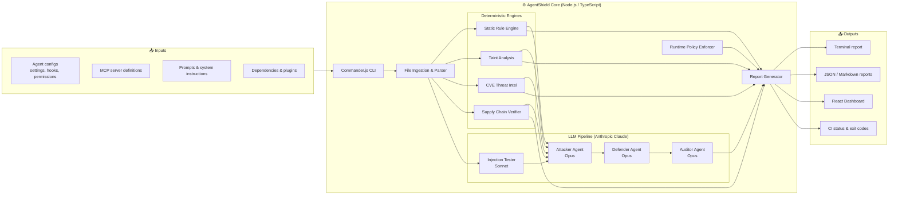
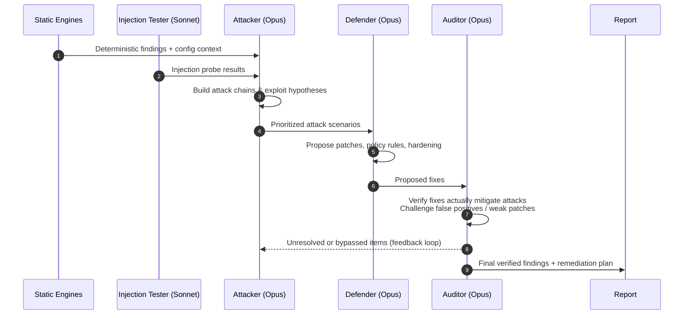

<div align="center">

# 🛡️ AgentShield

### AI Agent Security Platform — find, attack, defend, and audit your AI agents before someone else does.

[](https://github.com/<your-username>/agentshield/actions)
[](https://www.npmjs.com/package/ecc-agentshield)
[](https://www.typescriptlang.org/)
[](https://react.dev/)
[](https://www.anthropic.com/)
[](./LICENSE)

[Overview](#-overview) · [Architecture](#-system-architecture) · [Features](#-features) · [Getting Started](#-getting-started) · [CLI](#-cli-reference) · [Dashboard](#-dashboard) · [CI/CD](#-cicd-integration) · [Roadmap](#-roadmap)

<!-- TODO: replace with a real screenshot or GIF of the dashboard -->


</div>

---

## 📖 Table of Contents

1. [Overview](#-overview)
2. [Why AgentShield](#-why-agentshield)
3. [Features](#-features)
4. [System Architecture](#-system-architecture)
5. [Multi-Agent LLM Pipeline](#-multi-agent-llm-pipeline)
6. [Detection Layers](#-detection-layers)
7. [Dashboard](#-dashboard)
8. [Tech Stack](#-tech-stack)
9. [Project Structure](#-project-structure)
10. [Getting Started](#-getting-started)
11. [CLI Reference](#-cli-reference)
12. [Configuration](#-configuration)
13. [Reports & Output](#-reports--output)
14. [CI/CD Integration](#-cicd-integration)
15. [Security & Privacy Considerations](#-security--privacy-considerations)
16. [Roadmap](#-roadmap)
17. [Contributing](#-contributing)
18. [License](#-license)
19. [Author](#-author)

---

## 🔍 Overview

**AgentShield** is an end-to-end security platform for AI agents. As teams give LLM-powered agents access to tools, files, shells, APIs, and MCP servers, the attack surface moves from code to **configuration, prompts, permissions, and dependencies**. AgentShield analyzes that surface the way an attacker would, and then tells you how to fix it.

It combines three things in one product:

| Layer | What it is |
|---|---|
| **CLI scanner** | A Node.js/TypeScript command-line tool that statically analyzes AI agent configurations and produces security reports. |
| **Multi-agent LLM pipeline** | Three cooperating Claude-powered agents — **Attacker**, **Defender**, and **Auditor** — that red-team, patch, and verify findings. |
| **React dashboard** | A dark, cyberpunk-themed web console for live alerts, findings, charts, and an interactive terminal. |

> AgentShield sits at the intersection of **cybersecurity** and **AI/ML**: deterministic analysis (rules, taint tracking, CVE intelligence) is paired with genuine LLM reasoning (coordinated, role-specialized agents) rather than a single API call.

---

## 🎯 Why AgentShield

AI agents introduce risks that traditional SAST/DAST tools do not model:

- **Over-permissioned tools**: wildcard shell access, unrestricted file writes, broad network egress.
- **Prompt and tool-output injection**: untrusted content steering the agent into unintended actions.
- **Secrets in configs**: API keys, tokens, and credentials embedded in agent settings, hooks, or MCP definitions.
- **Supply chain exposure**: unverified MCP servers, plugins, and packages pulled into the agent runtime.
- **Unsafe hooks and automation**: lifecycle hooks that execute arbitrary commands.
- **No runtime guardrails**: nothing enforcing policy once the agent is actually running.

AgentShield closes those gaps with layered, explainable detection and actionable remediation.

---

## ✨ Features

- 🔎 **Static rule engine**: deterministic, explainable rules over agent configs, permissions, hooks, and MCP definitions (no ML required, fully offline).
- 🧬 **Taint analysis**: tracks untrusted data flowing from sources (user input, tool output, files, network) to dangerous sinks (shell, file write, network, credentials).
- 🛰️ **CVE threat intelligence**: matches dependencies and tools against known vulnerabilities.
- 📦 **Supply chain verification**: validates the provenance and integrity of packages, plugins, and MCP servers.
- 💉 **LLM injection testing**: automated prompt-injection probes against your agent's instructions (Claude Sonnet).
- ⚔️ **Attacker / Defender / Auditor agents**: coordinated multi-agent red-team → patch → verify loop (Claude Opus).
- 🚧 **Runtime policy enforcement**: declarative policies that allow, deny, or require approval for agent actions.
- 📊 **Rich reporting**: severity-ranked findings with remediation guidance, exportable for humans and CI.
- 🖥️ **Cyberpunk dashboard**: live alerts, stacked toasts, charts, and an interactive terminal with 50+ commands.
- 🔁 **CI/CD native**: drop-in GitHub Actions workflow that fails builds on policy violations.

---

## 🏗️ System Architecture

### High-level view



### Data flow

1. **Ingest**: the CLI discovers and parses agent configuration files, permission sets, hooks, MCP server definitions, and prompts.
2. **Analyze (deterministic)**: static rules, taint analysis, CVE matching, and supply chain checks run first. They are fast, offline-capable, and reproducible.
3. **Probe (LLM)**: the injection tester fires adversarial prompts at the agent's instructions using Claude Sonnet.
4. **Reason (multi-agent)**: the Attacker, Defender, and Auditor agents consume the deterministic findings and injection results, then iterate (see below).
5. **Enforce**: runtime policies are evaluated and merged into the findings.
6. **Report**: results are scored, ranked by severity, and delivered to the terminal, files, the dashboard, and CI.

### Layered design rationale

| Principle | How it shows up |
|---|---|
| **Deterministic first, LLM second** | Cheap, reproducible rules run before expensive, probabilistic agents, so the LLM reasons over verified evidence. |
| **Separation of duties** | Attacker, Defender, and Auditor have distinct prompts, goals, and outputs; no agent grades its own work. |
| **Graceful degradation** | The scanner works fully offline with rules only; LLM modes are opt-in. |
| **Explainability** | Every finding carries a rule/agent source, evidence, severity, and a remediation. |

---

## 🤖 Multi-Agent LLM Pipeline

AgentShield's AI layer is a coordinated pipeline, not a single prompt.



| Agent | Model | Role | Output |
|---|---|---|---|
| 🗡️ **Attacker** | Claude Opus | Thinks like an adversary: chains weaknesses into realistic exploit paths (injection → tool abuse → exfiltration). | Ranked attack scenarios with preconditions and impact. |
| 🛡️ **Defender** | Claude Opus | Designs mitigations: tightened permissions, policy rules, config patches, safer hook patterns. | Concrete remediations and policy suggestions. |
| 🔬 **Auditor** | Claude Opus | Independent verifier: checks whether the Defender's fixes truly close the Attacker's paths, and flags false positives. | Verified / unresolved status per finding and a final risk score. |
| 💉 **Injection Tester** | Claude Sonnet | High-volume, lower-cost probing of prompt-injection resilience. | Pass/fail results per probe category. |

**Why Opus for agents and Sonnet for injection testing?** Agent roles need deep multi-step reasoning, while injection testing is high-volume and benefits from speed and cost efficiency.

---

## 🧱 Detection Layers

### 1. Static Rule Engine
Pattern- and structure-based rules over parsed configurations. Examples of what it catches:
- Wildcard or overly broad tool permissions
- Hard-coded secrets and tokens
- Dangerous hook commands
- Unrestricted shell/file/network access
- Risky MCP server definitions

### 2. Taint Analysis
Models **sources → propagators → sinks**:

```
[ User input · Tool output · Fetched web content · File contents ]
                          │  (untrusted)
                          ▼
              [ Agent context / prompt ]
                          │
                          ▼
   [ Shell exec · File write · Network call · Credential access ]  ← sinks
```

Any untrusted path reaching a sensitive sink without sanitization or an approval gate is flagged.

### 3. CVE Threat Intelligence
Matches declared dependencies, tools, and MCP servers against known vulnerabilities and surfaces severity and fixed versions.

### 4. Supply Chain Verification
Validates the provenance, integrity, and trust level of packages, plugins, and MCP servers entering the agent runtime.

### 5. LLM Injection Testing
Automated adversarial probes (instruction override, role hijack, tool-output injection, data-exfiltration lures) against the agent's instructions.

### 6. Runtime Policy Enforcement
Declarative policies decide whether an agent action is **allowed**, **denied**, or **requires approval** (see [Configuration](#-configuration)).

### Severity model

| Severity | Meaning | Typical CI behavior |
|---|---|---|
| 🔴 **Critical** | Directly exploitable, high impact | Fail build |
| 🟠 **High** | Likely exploitable or high-impact misconfiguration | Fail build |
| 🟡 **Medium** | Weakness requiring specific conditions | Warn |
| 🔵 **Low** | Hardening opportunity | Informational |
| ⚪ **Info** | Best-practice note | Informational |

---

## 🖥️ Dashboard

A React + TypeScript web console with a deliberate **dark cyberpunk / neon** visual identity.

<!-- TODO: add screenshots -->
| Dashboard | Terminal |
|---|---|
|  |  |

### Highlights

- **Live alerts**: toast notifications with intelligent stacking so alerts never overlap.
- **Responsive layout**: sidebar/header structure that adapts across screen sizes.
- **Charts & metrics**: severity distribution, trends, and posture overview without overlap or spacing issues.
- **Interactive terminal**: a rich command-line experience inside the browser:
  - 10 command groups, 50+ commands
  - `Tab` autocomplete
  - `↑ / ↓` command history navigation
  - Clickable command reference panel
  - Quick-command strip for one-click actions
  - Per-command output simulations

> ℹ️ The in-browser terminal uses **simulated outputs** for demonstration. Real scans run through the CLI.

### Key UI modules

| File | Responsibility |
|---|---|
| `App.tsx` | Application shell and routing |
| `Header.tsx` | Top bar, status indicators |
| `Sidebar.tsx` | Primary navigation |
| `DashboardPage.tsx` | Metrics, charts, findings overview |
| `TerminalPage.tsx` | Interactive command terminal |
| `AlertToast.tsx` | Stacked, auto-dismissing alert notifications |
| `index.css` | Global styles and theme tokens |

### Design principles

- The cyberpunk/neon theme is **intentional**; UI changes must be non-destructive to it.
- Alerts, charts, and layout must stay readable at every breakpoint.

---

## 🧰 Tech Stack

| Area | Technology |
|---|---|
| **Language** | TypeScript, JavaScript |
| **Frontend** | React, TypeScript, Tailwind / custom CSS |
| **CLI** | Node.js, Commander.js |
| **AI / LLM** | Anthropic Claude API (Opus for agents, Sonnet for injection testing); optional Gemini mode |
| **Analysis** | Static rule engine, taint analysis, CVE intelligence, supply chain verification |
| **CI/CD** | GitHub Actions |
| **Tooling** | npm, TypeScript compiler, ESLint / Prettier |

---

## 📁 Project Structure

> Adjust to match your repository layout.

```text
agentshield/
├── .github/
│   └── workflows/
│       └── ci.yml                 # Build, test, and self-scan
├── src/
│   ├── cli/                       # Commander.js entrypoint & commands
│   ├── ingest/                    # Config discovery, parsing, file processing
│   ├── engines/
│   │   ├── rules/                 # Static rule engine
│   │   ├── taint/                 # Taint analysis
│   │   ├── cve/                   # CVE threat intelligence
│   │   └── supply-chain/          # Supply chain verification
│   ├── agents/
│   │   ├── attacker.ts
│   │   ├── defender.ts
│   │   ├── auditor.ts
│   │   └── injection-tester.ts
│   ├── policy/                    # Runtime policy enforcement
│   ├── report/                    # Report generation (terminal / JSON / MD)
│   └── index.ts
├── dashboard/
│   ├── src/
│   │   ├── components/            # Header, Sidebar, AlertToast, ...
│   │   ├── pages/                 # DashboardPage, TerminalPage
│   │   ├── App.tsx
│   │   └── index.css
│   └── package.json
├── docs/
│   └── assets/                    # Screenshots, diagrams
├── tests/
├── package.json
├── tsconfig.json
├── LICENSE
└── README.md
```

---

## 🚀 Getting Started

### Prerequisites

- **Node.js** ≥ 18
- **npm** ≥ 9
- An **Anthropic API key** (only required for LLM modes: agents and injection testing)

### Option A: run instantly with `npx`

```bash
npx ecc-agentshield scan
```

### Option B: install globally

```bash
npm install -g ecc-agentshield
agentshield --help
```

### Option C: from source

```bash
git clone https://github.com/<your-username>/agentshield.git
cd agentshield
npm install
npm run build
```

### Run the dashboard

```bash
cd dashboard
npm install
npm run dev        # development server
npm run build      # production build
```

### Environment variables

Create a `.env` file (never commit it):

```bash
# Required for LLM modes (agents + injection testing)
ANTHROPIC_API_KEY=sk-ant-...

# Optional: alternative provider for advanced mode
GEMINI_API_KEY=...
```

> 💡 **No API key?** Rule-based scanning (static rules, taint analysis, CVE and supply chain checks) works fully without any LLM.

---

## ⌨️ CLI Reference

> Confirm command names and flags against `agentshield --help` for your version.

```bash
agentshield <command> [options]
```

| Command | Description |
|---|---|
| `scan` | Run static analysis over agent configurations and produce a report. |
| `attack` | Run the Attacker agent to generate exploit scenarios. |
| `defend` | Run the Defender agent to propose mitigations. |
| `audit` | Run the Auditor agent to verify fixes and finalize risk. |
| `inject` | Run LLM prompt-injection tests. |
| `report` | Generate or export a report from previous results. |

### Common options

| Flag | Description |
|---|---|
| `-p, --path <dir>` | Directory to scan (default: current directory) |
| `-f, --format <type>` | Output format: `terminal`, `json`, `markdown` |
| `-o, --output <file>` | Write the report to a file |
| `--min-severity <level>` | Minimum severity to report |
| `--fail-on <level>` | Exit non-zero at or above this severity (CI) |
| `--advanced` | Enable LLM-powered analysis |
| `--model <name>` | Override the model used for advanced mode |

### Examples

```bash
# Fast, offline, rule-based scan
agentshield scan --path ./my-agent

# Full multi-agent analysis
agentshield scan --advanced --path ./my-agent

# JSON report, fail CI on high or critical findings
agentshield scan --format json --output report.json --fail-on high

# Injection testing only
agentshield inject --path ./my-agent
```

---

## ⚙️ Configuration

### `agentshield.config.json`

```json
{
  "path": ".",
  "minSeverity": "low",
  "failOn": "high",
  "advanced": false,
  "agents": {
    "attacker": { "model": "claude-opus" },
    "defender": { "model": "claude-opus" },
    "auditor": { "model": "claude-opus" },
    "injectionTester": { "model": "claude-sonnet" }
  },
  "ignore": ["node_modules", "dist", "**/*.test.*"]
}
```

### Runtime policy example

```json
{
  "version": 1,
  "defaultAction": "deny",
  "rules": [
    { "action": "shell.exec", "match": "git status", "effect": "allow" },
    { "action": "shell.exec", "match": "rm -rf *", "effect": "deny" },
    { "action": "network.request", "match": "*.internal.example.com", "effect": "require_approval" },
    { "action": "file.write", "match": "./src/**", "effect": "allow" }
  ]
}
```

---

## 📊 Reports & Output

Each finding includes:

```json
{
  "id": "AS-0042",
  "title": "Unrestricted shell permission",
  "severity": "high",
  "source": "static-rules",
  "location": ".agent/settings.json:12",
  "evidence": "\"allow\": [\"Bash(*)\"]",
  "impact": "Any prompt injection can execute arbitrary commands.",
  "remediation": "Replace the wildcard with an explicit allowlist of commands.",
  "verifiedBy": "auditor"
}
```

Formats: **terminal** (colorized), **JSON** (machine-readable), **Markdown** (PR comments and docs).

---

## 🔁 CI/CD Integration

Add `.github/workflows/agentshield.yml`:

```yaml
name: AgentShield

on:
  push:
    branches: [main]
  pull_request:

jobs:
  scan:
    runs-on: ubuntu-latest
    steps:
      - uses: actions/checkout@v4

      - uses: actions/setup-node@v4
        with:
          node-version: 20
          cache: npm

      - name: Install
        run: npm ci

      - name: Build
        run: npm run build

      - name: AgentShield scan
        run: npx ecc-agentshield scan --format json --output report.json --fail-on high
        env:
          ANTHROPIC_API_KEY: ${{ secrets.ANTHROPIC_API_KEY }}

      - name: Upload report
        if: always()
        uses: actions/upload-artifact@v4
        with:
          name: agentshield-report
          path: report.json
```

---

## 🔐 Security & Privacy Considerations

- **Local-first analysis**: rule-based scanning runs entirely on your machine.
- **LLM modes send context to a provider**: when `--advanced` is enabled, relevant config content is sent to the Anthropic API. Review what you scan and redact secrets first.
- **Secrets**: use environment variables or a secret manager; never commit `.env`.
- **Responsible use**: attacker-agent features are intended for testing systems **you own or are authorized to test**.
- **Reporting vulnerabilities**: see [`SECURITY.md`](./SECURITY.md) or open a private advisory.

---

## 🗺️ Roadmap

- [x] CLI scanner with static rule engine
- [x] Multi-agent LLM pipeline (Attacker / Defender / Auditor)
- [x] Taint analysis, CVE intel, supply chain verification
- [x] LLM injection testing
- [x] Runtime policy enforcement
- [x] React dashboard with interactive terminal
- [x] GitHub Actions integration
- [ ] Live dashboard ↔ CLI backend integration (replace simulated terminal output)
- [ ] SARIF export for GitHub code scanning
- [ ] Pluggable rule packs and community rules
- [ ] Additional LLM provider adapters
- [ ] Auto-fix pull requests from Defender output
- [ ] Historical trend tracking and team views

---

## 🤝 Contributing

Contributions are welcome!

1. Fork the repository
2. Create a branch: `git checkout -b feat/your-feature`
3. Commit with clear messages: `git commit -m "feat: add new rule"`
4. Run `npm run build` and tests
5. Push and open a Pull Request

Please keep dashboard changes consistent with the existing cyberpunk/neon theme.

---

## 📄 License

Distributed under the **MIT License**. See [`LICENSE`](./LICENSE) for details.

---

## 👤 Author

**Prajwal**
Computer Science & Engineering, Nitte Meenakshi Institute of Technology

- GitHub: [@your-username](https://github.com/<your-username>)
- LinkedIn: [your-profile](https://linkedin.com/in/<your-profile>)

---

<div align="center">

**If AgentShield helped you, consider giving it a ⭐**

*Secure the agent. Secure the future.*

</div>
